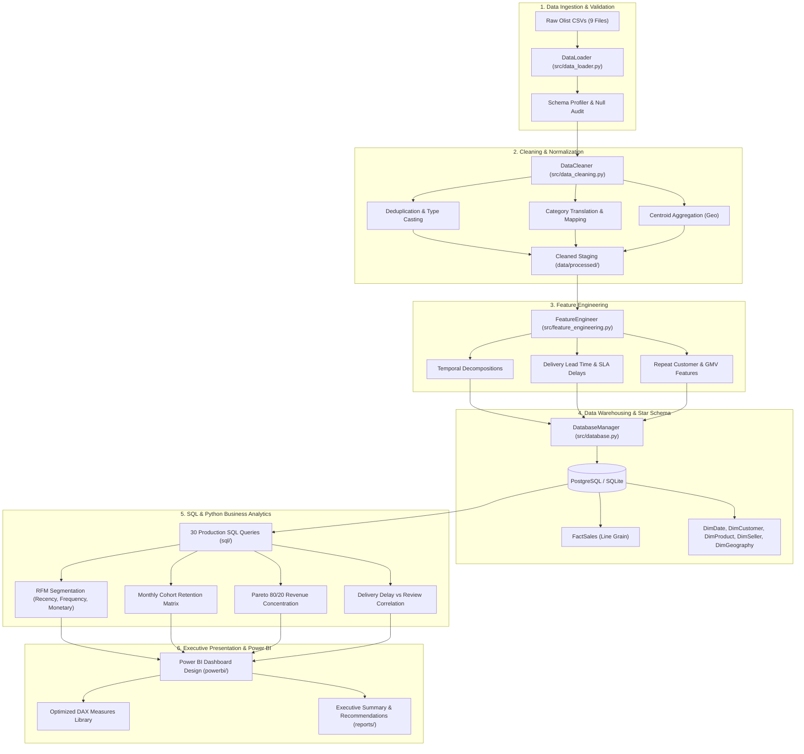

# E-Commerce Business Intelligence & Sales Analytics Platform

[](https://www.python.org/)
[](https://www.postgresql.org/)
[](https://powerbi.microsoft.com/)
[](LICENSE)

An enterprise-grade, end-to-end Business Intelligence and Data Engineering platform built on the **Brazilian E-Commerce Public Dataset by Olist** (~100,000 real-world commercial orders between 2016 and 2018).

This project demonstrates a production-grade analytics lifecycle: raw CSV ingestion, data validation, automated cleansing, feature engineering, normalized PostgreSQL schema design, dimensional Star Schema modeling, 30 advanced SQL analytical queries, RFM customer segmentation, cohort retention modeling, Pareto 80/20 product analysis, and executive Power BI dashboard architecture.

---

## Architecture & Data Flow



---

## 1. Business Problem & Project Objectives

Olist connects thousands of small merchants across Brazil to top e-commerce marketplaces. However, leadership faced critical blind spots:
1. **Severe Customer Churn:** What percentage of buyers return for a second purchase?
2. **Logistics Bottlenecks:** What is the exact customer review penalty for late deliveries, and which geographic regions suffer the worst transit friction?
3. **Supplier Risk:** How concentrated is marketplace revenue among top sellers and core product SKUs?
4. **Unit Economics:** What is the realistic Customer Lifetime Value (CLV) and marketplace commission take-rate given the absence of supplier COGS?

### Key Solution Deliverables:
- **Cleaned Data Pipeline:** Automated ingestion and auditing in `src/data_cleaning.py`.
- **Relational & Dimensional DDL:** Production SQL schema with constraints, indexes, and a Star Schema warehouse in `sql/01_database_schema.sql`.
- **30 Documented SQL Queries:** Spanning Sales, Customer Behavior, Product Taxonomies, Delivery Logistics, and Cohort Analytics.
- **Advanced Python Modeling:** Statistical RFM clustering, monthly cohort retention matrices, and Pareto 80/20 SKU distributions.
- **Power BI Implementation Guide:** A 5-page executive dashboard blueprint with dark navy design aesthetics and complete DAX measure formulas.

---

## 2. Dataset Structure

The dataset contains ~100k anonymized orders from 2016 to 2018 in Brazil:
- `olist_orders_dataset.csv`: Transaction backbone with order status and 5 lifecycle timestamps.
- `olist_order_items_dataset.csv`: Order item line grain with `price` and `freight_value`.
- `olist_customers_dataset.csv`: Customer mapping (`customer_id` checkout token to persistent `customer_unique_id`).
- `olist_products_dataset.csv`: Catalog specifications, dimensions, weights, and Portuguese category names.
- `olist_sellers_dataset.csv`: Merchant locations and zip code prefixes.
- `olist_order_payments_dataset.csv`: Payment methods, installment counts, and values.
- `olist_order_reviews_dataset.csv`: Customer review ratings (1 to 5 stars) and feedback timestamps.
- `olist_geolocation_dataset.csv`: Latitude and longitude coordinates for Brazilian zip prefixes.
- `product_category_name_translation.csv`: Portuguese-to-English category translation dictionary.

> **Note on Local Setup:** Refer to [DATASET_SETUP.md](DATASET_SETUP.md) for step-by-step instructions on staging the raw CSV files.

---

## 3. Technology Stack

- **Data Processing:** Python 3.12, Pandas, NumPy
- **Database & Modeling:** PostgreSQL 14+, SQLAlchemy 2.0, Psycopg2-binary, SQLite (fallback verification)
- **Business Intelligence & Dashboards:** Power BI Desktop, DAX (Data Analysis Expressions)
- **Visualizations:** Matplotlib (with `seaborn-v0_8-whitegrid` styling)
- **Quality Assurance & Testing:** Pytest 9.1+ (13 automated unit tests)
- **Environment Management:** Python-dotenv

---

## 4. Directory & Project Structure

```text
ecommerce-business-intelligence/
├── data/
│   ├── raw/                           # Raw Olist CSV datasets
│   ├── processed/                     # Cleaned, normalized CSV files
│   └── exports/                       # Analytical tables and exported charts
├── notebooks/
│   ├── 01_data_exploration.ipynb      # Schema profiling and initial distributions
│   ├── 02_data_cleaning.ipynb         # Step-by-step cleansing transformations
│   ├── 03_exploratory_data_analysis.ipynb # Feature generation and distributions
│   └── 04_business_insights.ipynb     # RFM segmentation and cohort matrices
├── src/
│   ├── config.py                      # Dynamic paths and database configuration
│   ├── data_loader.py                 # File verification, loading, and profiling
│   ├── data_cleaning.py               # Normalization, translation, and key checks
│   ├── feature_engineering.py         # Temporal, logistics, and behavioral metrics
│   ├── database.py                    # SQLAlchemy manager, DDL runner, star schema
│   └── analysis.py                    # RFM, cohort retention, and Pareto engines
├── sql/
│   ├── 01_database_schema.sql         # Relational DDL + Star Schema DDL + Indexes
│   ├── 02_data_validation.sql         # Key uniqueness and orphan foreign key checks
│   ├── 03_sales_analysis.sql          # Queries 1-8: Revenue, AOV, YoY, categories
│   ├── 04_customer_analysis.sql       # Queries 9-14: Repeat buyers, spenders, RFM
│   ├── 05_product_analysis.sql        # Queries 15-19: Top/bottom categories, freight
│   ├── 06_delivery_analysis.sql       # Queries 20-24: Lead time, delays vs reviews
│   └── 07_advanced_analysis.sql       # Queries 25-30: Cohort matrix, CLV, Pareto 80/20
├── powerbi/
│   ├── dashboard_design.md            # 5-page executive dashboard specification
│   ├── dax_measures.md                # Documented DAX measure formulas
│   └── dashboard_screenshots/         # Exported visual dashboard captures
├── reports/
│   ├── executive_summary.md           # Answers to 10 strategic business questions
│   ├── business_recommendations.md    # 5 prioritized strategic initiatives
│   └── data_quality_report.md         # Before/after cleaning audit
├── tests/
│   ├── test_data_cleaning.py          # Unit tests for cleansing rules
│   ├── test_data_validation.py        # Schema syntax and referential tests
│   └── test_metrics.py                # Metric, feature, and RFM unit tests
├── .env.example                       # Environment configuration template
├── .gitignore                         # Git exclusion rules
├── requirements.txt                   # Production Python dependencies
├── DATASET_SETUP.md                   # Raw dataset download instructions
├── README.md                          # Master documentation
└── main.py                            # Master orchestration entrypoint
```

---

## 5. Key Findings & Business Insights

### 1. Top Revenue Drivers
- **Health & Beauty** (R$ 1.26M, 9.5%), **Watches & Gifts** (R$ 1.21M, 9.1%), and **Bed/Bath/Table** (R$ 1.04M, 7.8%) are the top 3 merchandise categories, generating over 26% of platform volume.

### 2. Geographic Demand Disparity
- **São Paulo (SP)** generates 41.8% of total orders and 39.3% of merchandise revenue.
- The **Southeast Region (SP, RJ, MG)** commands **66.2% of national demand**.
- Delivery lead times vary from **8.3 days in SP** to **25–29 days in Northern states (AM, RR, AP)**.

### 3. The One-Time Purchase Dilemma
- **97.0% of unique buyers made only 1 purchase**. Only 3.0% (2,801 customers) returned for a second order.
- However, repeat buyers spent **38% more** and contributed 6.5% of total revenue.
- Month 1 retention across acquisition cohorts averaged **under 0.8%**.

### 4. The Delivery Satisfaction Cliff
- On-time / early deliveries average a **4.29★ rating**.
- Deliveries delayed by just 1 to 5 days drop to **2.57★** (with a 44% 1-star surge).
- Deliveries delayed >10 days drop to **1.35★** (with an 84% 1-star rate).

### 5. Product & Supplier Concentration
- **Pareto Law Validated:** **18.2% of catalog SKUs drive 80% of total revenue**.
- **Supplier Dependency:** The **top 5% of sellers generate 48.6% of marketplace GMV**.

---

## 6. Strategic Business Recommendations

1. **Launch Automated Replenishment Programs:** Deploy WhatsApp/email reorder prompts at 45/60/90 days for consumable categories (*Health & Beauty*, *Pet Supplies*) to double repeat buyers from 3% to 6%.
2. **Deploy Dynamic ML Delivery Estimates:** Replace static state-level 11-day safety buffers with dynamic postal-code ML predictions to eliminate checkout cart abandonment.
3. **Enforce 24-Hour Seller Dispatch SLAs:** Institute a 1% commission rebate for merchants dispatching packages within 24 hours to reduce late delivery breaches from 7.8% to <4.0%.
4. **Establish Regional Fulfillment Hubs in the Northeast:** Cross-dock long-haul freight in Recife/Salvador to cut delivery times to Northern/Northeastern states by 10–14 days.
5. **Catalog Rationalization & Class A SKU Protection:** Consolidate near-zero-turnover categories and maintain automated restock alerts on the 6,000 Class A SKUs.

---

## 7. Setup & Execution Instructions

### Step 1: Clone Repository & Create Virtual Environment
```bash
git clone https://github.com/yourusername/ecommerce-business-intelligence.git
cd ecommerce-business-intelligence

python -m venv venv
# Windows:
venv\Scripts\activate
# Linux/macOS:
source venv/bin/activate

pip install -r requirements.txt
```

### Step 2: Configure Environment Variables
Copy `.env.example` to `.env` and set your database connection parameters:
```bash
cp .env.example .env
```
*(By default, the platform automatically connects to PostgreSQL or seamlessly falls back to local SQLite if PostgreSQL is not active).*

### Step 3: Run the Automated Verification Suite
```bash
pytest tests -v
```
*(Executes all 13 unit tests validating data cleaning transformations, schema DDL, referential constraints, and RFM calculations).*

### Step 4: Execute Master Pipeline
```bash
python main.py
```

---

## 8. What I Learned

Through building this comprehensive e-commerce business intelligence platform, I developed hands-on technical and business competencies:

### 1. Advanced SQL & Data Warehousing
- **Window Functions for Business Metrics:** Utilized `LAG()` for MoM revenue velocity, `NTILE(5)` for quintile-based RFM scoring, and `SUM() OVER(ROWS BETWEEN UNBOUNDED PRECEDING AND CURRENT ROW)` for Pareto cumulative curves.
- **Relational vs. Dimensional Architecture:** Designed a 3NF relational OLTP schema with referential integrity constraints, and transformed it into an analytical Star Schema (`FactSales` joined to `DimDate`, `DimCustomer`, `DimProduct`, `DimSeller`, `DimGeography`).

### 2. Python Data Engineering & Cleansing
- **Deterministic Data Pipelines:** Engineered modular, idempotent cleaning functions in Pandas that handle messy real-world data (corrupted timestamps, unmapped Portuguese categories, multi-payment checkouts, and 1M+ coordinate centroids) without data loss.
- **Feature Engineering:** Developed temporal decompositions, delivery duration/delay metrics, and customer repeat behavior flags.

### 3. Business Analysis & Financial Acumen
- **Rigorous Financial Distinctions:** Clearly distinguished between actual merchandise revenue, freight charges paid to carriers, and checkout payment values, avoiding inflated profitability claims in the absence of supplier COGS data.
- **Cohort & Retention Modeling:** Built a monthly cohort retention matrix and demonstrated how low retention constrains permissible customer acquisition cost (CAC).

### 4. Power BI & DAX Modeling
- **Star Schema Performance:** Designed an executive-grade 5-page dashboard optimized for the VertiPaq tabular storage engine.
- **DAX Best Practices:** Formulated robust measures using `DIVIDE()`, time-intelligence (`DATESMTD`, `DATEADD`, `SAMEPERIODLASTYEAR`), and filter context management (`CALCULATE` and `KEEPFILTERS`).
